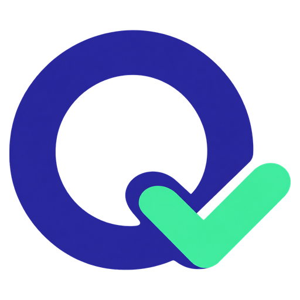

# Quieasy

Quieasy is a small Chrome and Arc extension for multiple-choice quizzes where looking things up is allowed: open-book quizzes, practice tests, trivia games, sample questions. Turn it on and it reads the questions on the page, asks an AI (with a web search) about each one, and puts a tiny gray dot on the answer it picked. The dot only shows while your mouse is over that choice. An answer key popup explains each answer and lists its sources.

It never clicks, types or submits anything. You still take the quiz yourself.

**Please only use it where outside help is okay.** On a closed-book test it is not, and your school will probably see it that way too. Also, the AI gets things wrong sometimes, so peek at the sources before you trust an answer.

## Install

There is no download yet, so you build it yourself. You need [Node.js](https://nodejs.org) 20 or newer and Chrome 140 or newer (Arc works too).

```sh
git clone https://github.com/picturesuo/Quieasy.git
cd Quieasy
npm ci
npm run build
```

Then go to `chrome://extensions` (Arc: `arc://extensions`), switch on **Developer mode**, click **Load unpacked** and pick the `dist` folder that was just created.

To update later, pull the new code, run `npm run build` again and hit reload on Quieasy's card.

## Add your AI key

Quieasy has no AI of its own. You bring a key from an AI service: a long code that lets apps use your account there. It works with Anthropic (Claude), OpenAI, Azure OpenAI and Amazon Bedrock. Open Quieasy's **Settings**, pick your service, paste the key and click **Save**.

A few things to know:

- Each question costs a little on that account, since the service bills per use.
- A ChatGPT subscription is not the same as an OpenAI key. You need the key.
- Your key stays in your browser and is only sent to the service it belongs to.

## Use it

| What | Shortcut (Mac: Option instead of Alt) |
| --- | --- |
| Turn on and read this tab | Alt+Shift+Q |
| Turn off | Alt+Shift+O |
| Open the answer key | Alt+Shift+K |

Quieasy starts off every time you open your browser. On Canvas (`*.instructure.com`) it works on every page once you turn it on. On any other site, press the On shortcut while that tab is in front. You can change the shortcuts at `chrome://extensions/shortcuts`.

Then hover over an answer choice. If the AI picked it, you see a faint dot. Questions the AI is unsure about get no dot. Turning Quieasy off clears everything.

## Privacy

Quieasy reads nothing until you turn it on, and it sends only the question and its answer choices to the AI service you picked. No cookies, no passwords, no page address, no tracking. The AI service does the web search. It only works on quizzes that are plain text on the page, so it will miss some. On some Canvas quizzes, opening the answer key may be logged as leaving the page.

Details are in [SECURITY.md](SECURITY.md).

## License

MIT. See [LICENSE](LICENSE).
